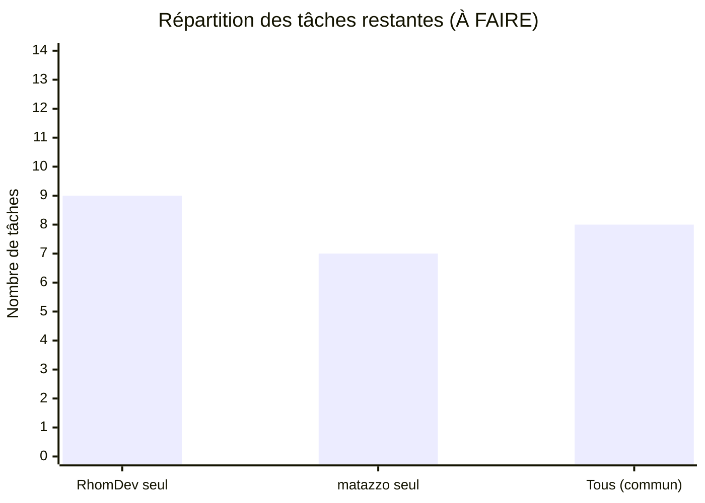
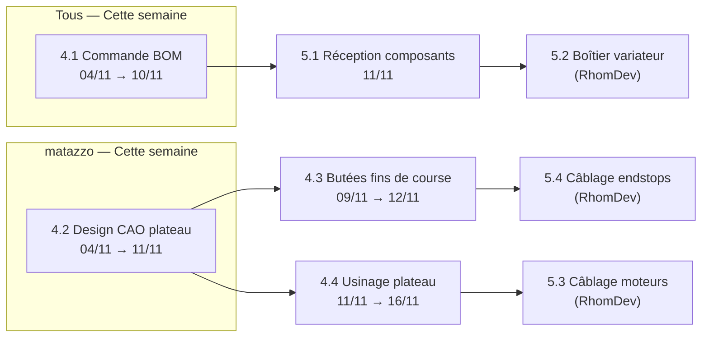

# 👤 Répartition des Tâches par Personne

> [!NOTE]
> Généré le **2026-11-03** à partir de la WBS Gantt du projet Broderie CNC.
> Les tâches sont classées par ordre chronologique d'exécution prévue.

---

## 📊 Vue d'ensemble de la charge

| Personne | ✅ Terminées | 🔲 À faire | Total |
|:---|:---:|:---:|:---:|
| **RhomDev** (seul) | 6 | 9 | 15 |
| **matazzo** (seul) | 4 | 7 | 11 |
| **Tous** (commun) | 6 | 8 | 14 |
| **Total** | **16** | **24** | **40** |

---

## 🔵 RhomDev

### ✅ Tâches terminées

| ID | Tâche | Phase | Date réalisée |
|:---:|:---|:---|:---:|
| 1.2 | Analyse de la machine Janome Facility 21 | Phase 1 | 29/09/2026 |
| 1.4 | Déploiement du coffre Obsidian & arborescence Git | Phase 1 | 02/10/2026 |
| 2.1 | Analyse de la carte MKS Base V1.4 (ATmega2560) | Phase 2 | 02/10/2026 |
| 2.2 | Étude du variateur AC RobotDyn (découpe de phase) | Phase 2 | 05/10/2026 |
| 2.3 | Étude théorique Fast PWM vs découpe de phase | Phase 2 | 02/10/2026 |
| 2.5 | Conception PCB comparateur AOP pour H21A1 | Phase 2 | 07/10/2026 |

### 🔲 Tâches à faire (par ordre chronologique)

| ID | Tâche | Phase | Prévu | Livrable | Dépend de |
|:---:|:---|:---|:---:|:---|:---:|
| 5.2 | Intégration sous boîtier sécurisé du variateur AC | Phase 5 | 12/11 → 16/11 | Boîtier 230V isolé | 5.1 |
| 5.3 | Câblage des moteurs pas-à-pas X/Y sur MKS Base | Phase 5 | 12/11 → 14/11 | Moteurs raccordés | 2.1, 4.4 |
| 5.4 | Câblage des fins de course (Aiguille PMH, X-Min, Y-Min) | Phase 5 | 13/11 → 16/11 | Faisceau endstops | 4.3 |
| 6.1 | Firmware : Routine d'interruption ZC & commande TRIAC | Phase 6 | 16/11 → 20/11 | Contrôle moteur AC | 5.2 |
| 6.2 | Firmware : Routine de décodage encodeur (vitesse) | Phase 6 | 18/11 → 21/11 | Mesure de rotation | 5.5 |
| 6.3 | Firmware : Séquence de Homing aiguille (PMH galet) | Phase 6 | 20/11 → 23/11 | Homing aiguille validé | 5.4, 6.1 |
| 6.4 | Firmware : Séquence de Homing plateau X/Y | Phase 6 | 21/11 → 24/11 | Homing axes X/Y validé | 5.3, 5.4 |
| 6.5 | Firmware : Machine à états de synchronisation aiguille | Phase 6 | 24/11 → 30/11 | Fenêtre d'avance sûre | 6.2, 6.3, 6.4 |
| 6.6 | Firmware : Interpréteur G-code (mouvements X/Y) | Phase 6 | 27/11 → 02/12 | Décodage G0/G1 | 6.5 |

> [!IMPORTANT]
> **RhomDev** est sur le **chemin critique** du projet : les phases 5 (câblage) et 6 (firmware) conditionnent directement les tests d'intégration de la Phase 8. Tout retard se répercute sur la deadline de Noël (18/12).

---

## 🟢 matazzo

### ✅ Tâches terminées

| ID | Tâche | Phase | Date réalisée |
|:---:|:---|:---|:---:|
| 2.4 | Étude initiale de la fourche optique H21A1 | Phase 2 | 03/10/2026 |
| 2.6 | Essais comparateur (LM318, TL081, LM393) | Phase 2 | 23/10/2026 |
| 2.7 | Dimensionnement cinématique poulie encodeur | Phase 2 | 23/10/2026 |
| 3.4 | Validation de l'encodeur rotatif SEN0230 | Phase 3 | 03/11/2026 |

### 🔲 Tâches à faire (par ordre chronologique)

| ID | Tâche | Phase | Prévu | Livrable | Dépend de |
|:---:|:---|:---|:---:|:---|:---:|
| 4.2 | Revoir le design CAO du plateau de travail XY | Phase 4 | 04/11 → 11/11 | Modèle 3D plateau | 3.1 |
| 4.3 | Supports et butées des fins de course plateau X/Y | Phase 4 | 09/11 → 12/11 | Butées X/Y installées | 4.2 |
| 4.4 | Fabrication / usinage du nouveau plateau de travail | Phase 4 | 11/11 → 16/11 | Plateau assemblé | 4.2 |
| 7.1 | Streamer USB série robuste (serial_bridge.py) | Phase 7 | 20/11 → 24/11 | Pont série avec ack 'ok' | 2.1 |
| 7.2 | Module de vectorisation & extraction des points (SVG) | Phase 7 | 24/11 → 30/11 | Script vectorisation | 7.1 |
| 7.3 | Générateur de G-code spécialisé broderie | Phase 7 | 30/11 → 04/12 | Fichier G-code généré | 7.2 |
| 7.4 | Visualiseur 2D de trajectoires avant broderie | Phase 7 | 03/12 → 07/12 | IHM ou plot matplotlib | 7.3 |

> [!IMPORTANT]
> **matazzo** a deux axes parallèles : la **mécanique plateau** (Phase 4, immédiat) et la **suite Python** (Phase 7, à partir du 20/11). La Phase 4 doit être terminée avant le 16/11 pour débloquer le câblage de RhomDev.

---

## 🟡 Tous (RhomDev + matazzo)

### ✅ Tâches terminées

| ID | Tâche | Phase | Date réalisée |
|:---:|:---|:---|:---:|
| 1.1 | Prise en main du sujet & définition du besoin | Phase 1 | 28/09/2026 |
| 1.3 | Rédaction du Cahier des Charges fonctionnel | Phase 1 | 01/10/2026 |
| 3.1 | Test manuel de couture machine (Janome) | Phase 3 | 02/11/2026 |
| 3.2 | Décision : abandon H21A1 au profit du fin de course | Phase 3 | 02/11/2026 |
| 3.3 | Choix du fin de course à galet (PMH & homing) | Phase 3 | 03/11/2026 |
| 3.5 | Établissement de la liste des besoins (BOM) | Phase 3 | 03/11/2026 |

### 🔲 Tâches à faire (par ordre chronologique)

| ID | Tâche | Phase | Prévu | Livrable | Dépend de |
|:---:|:---|:---|:---:|:---|:---:|
| 4.1 | Commande des composants et fournitures (BOM) | Phase 4 | 04/11 → 10/11 | Bons de commande | 3.5 |
| 5.1 | Réception & vérification des composants | Phase 5 | 11/11 → 12/11 | Matériel réceptionné | 4.1 |
| 5.5 | Validation électrique globale sous tension (12V & 230V) | Phase 5 | 17/11 → 19/11 | Banc électrique validé | 5.2, 5.3, 5.4 |
| 8.1 | Essais à vide : synchronisation mouvement sans fil | Phase 8 | 04/12 → 08/12 | Cycle synchronisé | 6.6, 7.1 |
| 8.2 | Première broderie réelle : ligne droite & carré auto | Phase 8 | 08/12 → 11/12 | Premier échantillon | 8.1, 7.3 |
| 8.3 | Optimisation de vitesse & réglage de la découpe AC | Phase 8 | 11/12 → 15/12 | Cadence maximale | 8.2 |
| 8.4 | Broderie d'un motif complexe complet avant Noël | Phase 8 | 15/12 → 18/12 | Démonstrateur textile | 8.3, 7.4 |
| 9.1 | Rédaction intensive du rapport de synthèse (LaTeX) | Phase 9 | 04/01 → 15/01 | rapport.tex | 8.4 |
| 9.2 | Préparation du diaporama & vidéo de démonstration | Phase 9 | 15/01 → 22/01 | Présentation + vidéo | 9.1 |
| 9.3 | Répétitions orales & calage du timing (20-30 min) | Phase 9 | 22/01 → 27/01 | Équipe prête | 9.2 |
| 9.4 | 🎓 SOUTENANCE ORALE FINALE | Phase 9 | **28/01/2027** | Présentation jury | 9.3 |

---

## 🗓️ Prochaines actions immédiates (semaine du 03/11)

> [!TIP]
> **Cette semaine**, les deux priorités absolues sont :
> 1. **Tous** → Passer la commande BOM (tâche 4.1) — débloque toute la phase 5
> 2. **matazzo** → Lancer le redesign CAO du plateau (tâche 4.2) — débloque 4.3, 4.4, puis le câblage de RhomDev
